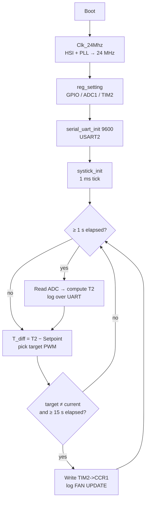

# STM32-DriverPWM

A temperature-controlled **PWM fan driver** for the **NUCLEO-F446RE (STM32F446RE)**.
It reads an NTC thermistor through the ADC, then steps the TIM2 PWM duty cycle according to how far the temperature is above a target setpoint. Status is logged over UART.

The code is written at **register level** (only the CMSIS header `stm32f446xx.h`, no HAL) and built with PlatformIO.

> This README covers **how the code works**. The circuit and reference documents are in `Circuit/` and `Document/`.

---

## Overview



1. Configure the system clock to 24 MHz.
2. Configure the GPIO pins, ADC1 and TIM2 (PWM).
3. Start UART and SysTick.
4. Run an endless loop:
   - Every 1 second, read the ADC and convert it to a temperature.
   - Compute `T_diff` and select a PWM level.
   - If the new level differs from the current one **and** at least **15 seconds** have passed since the last level change, update the PWM.

---

## Hardware and pins

| Function | Pin | Peripheral | Notes |
|---|---|---|---|
| Temperature sensing (NTC) | `PA0` | ADC1 channel 0 | Analog mode |
| Fan drive (PWM) | `PA5` | TIM2_CH1 | Alternate function **AF1** |

The sensing circuit is a voltage divider with a **10 kΩ pull-up resistor to 3.3 V** and the NTC to GND. The midpoint goes to `PA0`.

---

## Code walkthrough

### 1. Clock — `src/Clk/Clk.c`
Starts from the 16 MHz HSI and runs it through the PLL to get a 24 MHz SYSCLK.

```
f_VCO  = 16 MHz / PLLM(8) × PLLN(96) = 192 MHz
SYSCLK = 192 MHz / PLLP(8)           = 24 MHz
```

The AHB, APB1 and APB2 prescalers are all /1, so peripheral and timer clocks are also 24 MHz.
Flash latency, prefetch and cache are configured, and the code waits for PLL lock before switching the system clock to the PLL.

### 2. Peripherals — `src/Reg/Reg.c` (`reg_setting`)
- Enables clocks for GPIOA, TIM2 and ADC1.
- `PA0` is set to Analog, `PA5` to Alternate function (AF1 = TIM2_CH1).
- **ADC1**: enabled, one regular conversion on channel 0, single-conversion mode, 12-bit.
- **TIM2** (PWM mode 1, preload enabled on CCR1):

| Parameter | Value | Result |
|---|---|---|
| `PSC` | 23 | timer tick = 24 MHz / 24 = **1 MHz** |
| `ARR` | 2499 | period = 2500 ticks = 2.5 ms |
| PWM frequency | | **400 Hz** |
| Duty cycle | `CCR1 / 2500` | set through `TIM2->CCR1` |

### 3. SysTick — `src/SysTicker/SysTicker.c`
Configures SysTick to interrupt every **1 ms** (`LOAD = 24000 − 1`) and increments the `ms_ticks` counter inside `SysTick_Handler`.
`ms_ticks` is the time base for both the 1 s temperature reading and the 15 s hold between fan level changes.

### 4. UART — `src/Uart/Uart.c`
- USART2 on `PA2`/`PA3`, 9600 baud (`BRR = 24 MHz / baud`), TX and RX enabled.
- `uart_write(ch)` sends one character (waits for TXE).
- `uart_print(str)` sends a whole string.

### 5. Temperature calculation — `input_temp_cal()`
Starts a software-triggered conversion, waits for the EOC flag, then converts the reading:

```
V_adc    = 3.3 × ADC / 4095
R_sensor = 10 kΩ × V_adc / (3.3 − V_adc)

1/T = 1/T0 + (1/B) × ln(R_sensor / R0)        (Beta equation)
T0 = 15 °C (288.15 K),  R0 = 2341 Ω,  B = 3820

T2 (°C) = T − 273.15
```

Results are stored in the globals `T2` (°C) and `r_sensor` (Ω).

### 6. Fan control logic — `main()`
The temperature is compared with the setpoint (`initial_setpoint = 23.0 °C`), and the level is chosen from `T_diff = T2 − Setpoint`:

| `T_diff` condition (°C) | `CCR1` | Duty | RPM (shown in log) |
|---|---|---|---|
| `> 4.0` | 2499 | ≈ 100 % | 5000 |
| `3.0 … 4.0` | 1999 | 80 % | 4000 |
| `2.0 … < 3.0` | 1499 | 60 % | 3000 |
| `1.0 … < 2.0` | 999 | 40 % | 2000 |
| `> −1.0 … < 1.0` | 499 | 20 % | 1000 |
| `≤ −1.0` | 0 | 0 % (off) | 0 |

Behavior notes:
- **15-second hold**: consecutive level changes must be at least 15 s apart, which prevents the fan from changing speed too often.
  `last_stage_time` starts at 0, so after power-up **the fan stays off until 15 s have passed**, even if the temperature already calls for it to run.
- The RPM values in the log are the nominal values assigned to each PWM level. They are **not measured** (there is no tachometer feedback).

### 7. Debug mode
Set `bool Debug = true;` in `STM32-DriverPWM.c` to **simulate the temperature** without a sensor.
`T2` starts at 30 °C and changes by 0.75 °C every second, bouncing between 20 and 32 °C. This is useful for testing the fan-level logic and the 15 s hold.

---

## Example UART output (9600 baud)

```
--- START FAN CONTROL SYSTEM ---
Target Setpoint Initially Set to: 23 C

[Temp] T2: 30.750 C (T_Diff: 7.750) Resister = ...
>>> [15s DELAY PASSED] FAN UPDATE: PWM = 100 % (5000 RPM)
```

---

## Source layout

```
STM32-DriverPWM/
├── platformio.ini
└── src/
    ├── STM32-DriverPWM.c      # main loop, temperature calculation, fan control logic
    ├── Clk/                   # 24 MHz clock setup (HSI + PLL)
    ├── Reg/                   # GPIO, ADC1, TIM2 configuration
    ├── SysTicker/             # ms_ticks time base
    └── Uart/                  # USART2 for logging
```

## Build and flash

Uses [PlatformIO](https://platformio.org/) (already configured in `platformio.ini`).

```ini
[env:nucleo_f446re]
platform = ststm32
board = nucleo_f446re
framework = stm32cube
build_flags = -Wl,-u,_printf_float   ; lets printf/sprintf print floats
```

```bash
pio run                      # build
pio run -t upload            # flash via ST-LINK
pio device monitor -b 9600   # view the UART log
```

> **Note**: the `#include` lines in `STM32-DriverPWM.c` use backslashes (e.g. `"Clk\Clk.h"`), which work on Windows.
> To build on Linux/macOS, change them to forward slashes (e.g. `"Clk/Clk.h"`).
